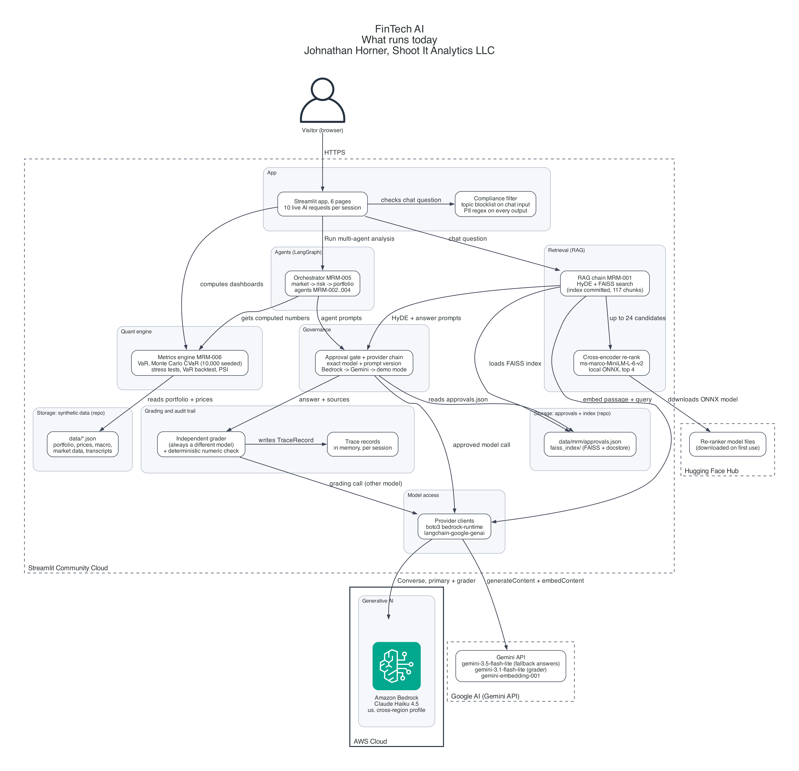
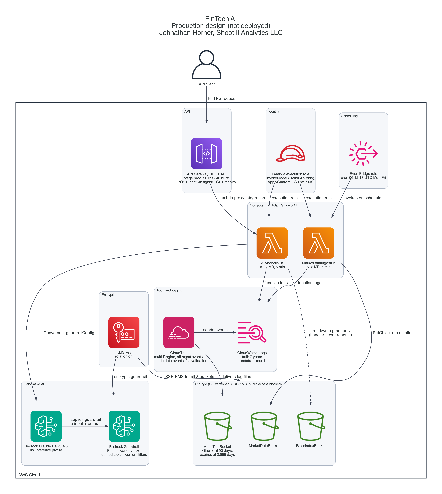

# FinTech AI: Hedge Fund Intelligence


[](https://fintech-ai-horner.streamlit.app)
[](https://www.python.org/downloads/)
[](LICENSE)

**Status: Live.** https://fintech-ai-horner.streamlit.app (checked 2026-11-16: a chat answer came from Amazon Bedrock Claude Haiku 4.5; the free Streamlit host puts the app to sleep when idle and it wakes on the first visit). Live answers try Bedrock first and fall back to Google Gemini; all five AI components passed held-out validation on both.

Independent reference project by Shoot It Analytics LLC. Built with public or synthetic data.

Live app: https://fintech-ai-horner.streamlit.app

## What it does today

FinTech AI analyzes a synthetic hedge fund portfolio (15 positions, $32.36M AUM). All data is synthetic and bundled in `data/`. No real client data is used.

- **Portfolio Overview:** AUM, P&L, weighted beta, sector weights and positions, computed from `data/portfolio.json`.
- **Market Analysis, Risk Assessment, Portfolio Management:** one button runs a LangGraph pipeline of three agents (market, risk, portfolio). Every number the agents see is computed by code first: parametric VaR, Monte Carlo CVaR, stress tests, risk scores, Sharpe, Sortino, drawdown, volume and macro changes. The agents are told not to compute numbers of their own.
- **AI Chat:** questions over the bundled data. Retrieval uses HyDE (the model writes a hypothetical answer, and that answer is used for the FAISS search), then a local cross-encoder re-ranks the results and the top 4 go to the answer prompt.
- **Model Risk Management:** a 6-model inventory, held-out validation results, an out-of-sample VaR backtest, PSI drift monitoring, governance checks and a CRO report, all computed by `src/mrm/`.

Every AI output carries:

- a label naming the provider and model that actually answered, or "Demo mode" with the reason,
- a score from an independent grader, which is always a different model from the one that answered,
- a trace record with the inventory ID, model, prompt versions and approval status.

Live AI is capped at 10 requests per browser session. When live AI is not available, the app shows deterministic output built from the same computed numbers.

## Case study

Built by Johnathan Horner, Shoot It Analytics LLC. The same case study is on the [portfolio](https://portfolio.johnathancloudspace.com/#fintech-ai).

### The problem

Banks that put language models near investment decisions have to manage them as models under SR 26-2 (formerly SR 11-7): an inventory, independent validation, ongoing monitoring and a record of what each model said. Most AI assistants skip all of that.

### Why I built it

I wanted to see whether those controls could live in the code rather than in a policy document: numbers computed before the model sees them, only validated model and prompt versions allowed to answer, and every answer graded and traced.

### Key decisions

1. **An approval gate keyed to the exact model and prompt hash.** Each LLM component may call a provider only if the held-out evaluation recorded an approval for that provider, model ID and prompt version hash, and only the evaluation harness writes approvals. Any prompt or model change blocks live use until a new held-out run approves it; meanwhile the app falls back.
2. **Code computes every number; the model only explains.** Monte Carlo CVaR (10,000 seeded runs), VaR, stress tests and PSI drift are computed first, and the agents are told to use only those numbers. Earlier failures came from the model doing its own arithmetic. The agents can only discuss what the engine computed.
3. **Bedrock first, Gemini as fallback, and a grader that is always a different model.** Claude Haiku 4.5 answers through the US cross-Region inference profile, Gemini takes over on any Bedrock error, and demo mode is last. Every output gets an LLM grade from a different model plus a deterministic number check. The cost is two vendors and two prompt sets to validate, and Gemini is always needed for embeddings.
4. **Production stack in CDK, synthesized in CI, not deployed.** Bedrock Guardrails, KMS, CloudTrail with 7-year retention, API Gateway and Lambda are defined and checked by cdk synth on every push, with no AWS spend. Those controls are designed, not exercised, and the CDK Lambda does not yet carry the approval gate, RAG or grader.

### Architecture

The diagram and the flow are in [Architecture](#architecture) below.

### Governance and safety

- Approval gate: only APPROVED or CONDITIONAL records for the exact provider, model ID and prompt hash may answer; approvals are written only by the held-out evaluation harness.
- Model inventory of 6 models (MRM-001 to MRM-006) with risk tier, lifecycle stage and validation status.
- Independent grader on every live output (always a different model) plus a check that every number rounds from a source number; marked UNGRADED if no other model is available.
- A trace record per output: provider, model, prompt versions, index hash, sources, grade, approval status and latency.
- A topic filter refuses insider-trading and market-manipulation questions, a PII regex redacts every output, live use is capped at 10 requests per session, and every output names the provider and model that answered.
- Not in the running app: Bedrock Guardrails, KMS and CloudTrail (defined in CDK only), human review, and a durable audit log (traces are kept in memory).

### Results

- Held-out RAG chat (MRM-001), latest run on 2026-11-11: 23 of 23 passed on Claude Haiku 4.5 with 100% exact-fact accuracy, for $0.067 of Bedrock calls; the Gemini fallback also passed 23 of 23. On a 23-item set, one item is about 4 points.
- Agents on held-out sets with Claude Haiku 4.5: market 10/10, risk 9/10, portfolio 10/10, orchestrator 9/10, all approved.
- 99% VaR backtest over 254 test days: 2 to 3 exceptions, Kupiec p-value 0.72 to 0.78, Basel green zone.
- 118 automated tests in CI, plus cdk synth of the production stack.

### Limits

Synthetic portfolio and market data, small held-out sets (23 chat items, 10 per agent), not reviewed by an independent validation team or a regulator, and not investment advice.

### What I'd do in a real deployment

Deploy the CDK stack with the approval gate, RAG and grader inside the Lambda, apply Bedrock Guardrails to every call, keep traces in a durable audit store, use the bank's own market data, and have an independent validation team review it before anyone relies on it.

### Links

- Live app: https://fintech-ai-horner.streamlit.app
- GitHub: https://github.com/johnathan-horner/fintech-ai
- Diagram: [docs/architecture/architecture.png](docs/architecture/architecture.png)
- Production design: [docs/architecture/production-design.png](docs/architecture/production-design.png)

## Architecture



A chat question passes a topic filter, then the RAG chain writes a hypothetical answer (HyDE), searches the committed FAISS index with it and the raw question, re-ranks to the top 4 with a local cross-encoder, and asks the approval gate which provider may answer: Claude Haiku 4.5 on Amazon Bedrock, then Gemini, then demo mode. A different model grades the answer, a number check runs, and a trace record is shown under it. The second diagram is the production design in the repo's CDK code, synthesized in CI and not deployed.

**Production design (not deployed).**



The diagrams are built with the Python `diagrams` library from [`docs/architecture/`](docs/architecture/). Each arrow is checked against the code and, for AWS calls, the AWS documentation; see [`docs/architecture/arrow-verification.md`](docs/architecture/arrow-verification.md). A 1200x1500 copy of each diagram (`*-linkedin.png`) is in the same folder.

Agents: START -> Market Analysis Agent (MRM-002) -> Risk Assessment Agent (MRM-003) -> Portfolio Management Agent (MRM-004) -> END, run by the orchestrator (MRM-005). The RAG chain is MRM-001. The metrics engine is MRM-006.

**Provider order.** Bedrock Claude Haiku 4.5 (`us.anthropic.claude-haiku-4-5-20251001-v1:0`) is tried first. Any Bedrock error, throttle, missing credentials or missing approval falls through to Gemini (`gemini-3.5-flash-lite`). If no live provider works, the app shows demo mode.

**Governance gate.** Approvals live in `data/mrm/approvals.json` and are written only by the evaluation harness. Each approval is tied to a component, provider, model ID and prompt versions. Before any model call, the gate checks the exact version that is about to run. A version that is not approved is skipped for that provider.

**Production target.** `infra/` is AWS CDK code (Bedrock Guardrails, KMS, CloudTrail with 7-year retention, Lambda, API Gateway, least-privilege IAM). It passes `cdk synth` in CI. It is not deployed and is not used by the live demo.

## Measured evaluation (held-out split)

How it is measured: `python scripts/run_eval.py --split heldout` on the held-out half of `data/eval/fintech_eval.jsonl` (127 items: 47 RAG questions with reference answers computed from the data, plus 20 portfolio variants for each agent component; seeded 50/50 split per component, see `src/eval/dataset.py`). An item passes when the independent grader returns PASS with groundedness of at least 0.8, the numeric check finds no number that is not in the sources, and, for exact-fact items, every reference value appears in the answer. APPROVED needs a pass rate of at least 0.85 and mean groundedness of at least 0.80. CONDITIONAL needs a pass rate of at least 0.70. Agent results use 10 held-out items each, so treat them as smoke-level checks.

**Bedrock Claude Haiku 4.5 (primary).** Answers by Haiku 4.5, graded by `gemini-3.1-flash-lite`.

| Component | Prompt version | Held-out items | Passed | Mean groundedness | Exact-fact accuracy | Status | Eval run |
|---|---|---|---|---|---|---|---|
| MRM-001 RAG chat | rag_answer_haiku@1.0.0 | 23 | 23/23 (1.000) | 1.000 | 1.000 | APPROVED | heldout-20261111T014446Z-bedrock |
| MRM-002 Market agent | market_analysis_haiku@1.0.0 | 10 | 10/10 | 0.991 | n/a | APPROVED | heldout-20260930T163311Z-bedrock |
| MRM-003 Risk agent | risk_report@1.2.0 | 10 | 9/10 | 0.996 | n/a | APPROVED | heldout-20260930T152404Z-bedrock |
| MRM-004 Portfolio agent | portfolio_recommendations_haiku@1.0.0 | 10 | 10/10 | 1.000 | n/a | APPROVED | heldout-20260930T164023Z-bedrock |
| MRM-005 Orchestrator (all 3 sections must pass) | the three agent prompts above | 10 | 9/10 | 0.991 | n/a | APPROVED | heldout-20261016T064021Z-bedrock |

Measured Bedrock cost of these runs, from Bedrock usage data: MRM-001 $0.067 (2026-11-10 run), MRM-002 $0.125, MRM-003 $0.083, MRM-004 $0.062, MRM-005 $0.272.

**Gemini (fallback).** Answers by `gemini-3.5-flash-lite`, graded by `gemini-3.1-flash-lite`.

| Component | Held-out items | Passed | Mean groundedness | Exact-fact accuracy | Status | Eval run |
|---|---|---|---|---|---|---|
| MRM-001 RAG chat | 23 | 23/23 (1.000) | 1.000 | 1.000 | APPROVED | heldout-20261111T014939Z |
| MRM-002 Market agent | 10 | 10/10 | 1.000 | n/a | APPROVED | heldout-20260930T004656Z |
| MRM-003 Risk agent | 10 | 10/10 | 1.000 | n/a | APPROVED | heldout-20260930T010751Z |
| MRM-004 Portfolio agent | 10 | 10/10 | 1.000 | n/a | APPROVED | heldout-20260930T010751Z |
| MRM-005 Orchestrator | 10 | 10/10 | 0.999 | n/a | APPROVED | heldout-20260930T005058Z |

All result files are in `data/eval/results/`. Earlier Haiku runs with the shared prompts (heldout-20260930T142057Z to T153729Z, bedrock) scored lower: MRM-002 and MRM-005 FAILED, mostly because Haiku mislabeled return periods. That led to the Haiku-specific prompts above.

MRM-001 was re-measured on 2026-11-10 after one change to the retrieval data: a new document, `fund:pnl_ranking`, ranks all 15 positions by unrealized P&L. Each position is its own document and the chat sees only the top 4 re-ranked chunks, so it could not answer questions that compare every position; on 2026-11-10 the live chat said the data did not show which position had the largest unrealized loss (it is CVX, -$923,765.75). Before the change both providers scored 22/23 (exact-fact accuracy 0.952): Gemini missed the list of positions with losses (`heldout-20260929T210703Z`), and Bedrock missed the largest position by market value because the fund summary was not retrieved (`heldout-20260930T160709Z-bedrock`). After the change both scored 23/23. The Gemini gain comes from the new document. The Bedrock miss was on a question the change does not touch, so that gain is run-to-run variation in retrieval, not the fix. With 23 questions, one item moves the pass rate by about 4 points.

VaR backtest (MRM-006): out-of-sample 99% VaR on a rolling 250-day window over seeded synthetic prices, 254 test days, 2 to 3 exceptions depending on method, Kupiec p-values 0.72 to 0.78, Basel GREEN (run `heldout-20260929T210703Z`).

Re-checked on 2026-10-23: running `portfolio_backtest()` from `src/mrm/validation/model_validator.py` reproduces these backtest numbers (historical 3 exceptions, p = 0.778; parametric and beta-proxy 2 exceptions, p = 0.724), and the full test suite passed (118 tests at that time; 154 on 2026-11-10).

## How to run it

Requires Python 3.11.

```bash
git clone https://github.com/johnathan-horner/fintech-ai.git
cd fintech-ai
python3 -m venv .venv && source .venv/bin/activate
pip install -r requirements.txt -r requirements-dev.txt
streamlit run streamlit_app/streamlit_app.py
```

The app runs without any keys, in demo mode. For live AI, add `.streamlit/secrets.toml` (see `.streamlit/secrets.toml.template`):

- `[aws]` with `access_key_id`, `secret_access_key` and `region` for Bedrock (primary)
- `[gemini]` with `api_key` for Gemini (fallback, and required for embeddings)

Other commands:

```bash
pytest -q                                              # tests, no network
pip install -r requirements-api.txt && uvicorn src.api.main:app --reload   # FastAPI, 22 endpoints
python scripts/run_eval.py --provider bedrock --dry-run                    # Bedrock cost estimate, no calls
python scripts/run_eval.py --split heldout --provider bedrock --components MRM-002 --max-cost 1.00
```

The MCP server needs its own environment: `pip install -r requirements-mcp.txt && python mcp_server.py`. Its 6 tools return values computed from the bundled data.

## Limits

- Synthetic portfolio and prices. Results on real markets would differ.
- The held-out evaluation set is small (23 RAG questions, 10 items for each agent and the orchestrator).
- The grader is itself a language model and can be wrong; a deterministic numeric check backs it up.
- Live Bedrock answers need a valid AWS key in the app's Streamlit secrets; without one the app falls back to Gemini, then to demo mode.
- The AWS CDK stack in `infra/` passes `cdk synth` but has never been deployed.

## What's next

These are not built yet:

- Live market data from FRED and SEC EDGAR, shown next to the synthetic portfolio
- Fundamental Analysis and Compliance agents
- Sentiment analysis of earnings transcripts
- Bias checks in the evaluation harness
- A scheduled daily monitoring job
- An AI commentary tool in the MCP server, and positioning recommendations
- Performance attribution
- LangChain LCEL chains
- Titan embeddings for the production path
- Full exit and new-position recommendations (today the portfolio agent recommends reduce, trim, hedge, hold or add)
- Formal SR 26-2 (formerly SR 11-7) attestation by an independent validation team (today the repo implements the framework in code)

## More detail

- [AI_SYSTEM_CARD.md](AI_SYSTEM_CARD.md): system card
- [docs/decisions/](docs/decisions/): architecture decision records
- [.github/workflows/ci.yml](.github/workflows/ci.yml): CI (pytest, MCP import, cdk synth)

Built by Johnathan Horner
